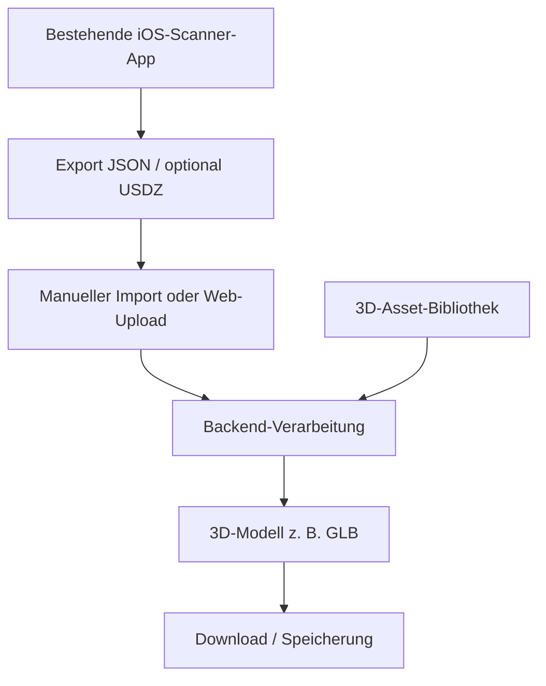

# Architektur 1 – Externe Scanner-App und eigene Verarbeitungspipeline

> **Vorschlag, nicht beschlossen.** Muss mit dem [Betreuer](decision.md) diskutiert werden. Die Datenverfügbarkeit wird im [Handytest](../testing/handytests.md) geprüft.

[Dokumentation](../README.md) · [Architektur 2](option-2-integrated-ios-app.md) · [Vergleich](decision.md) · [System-Flows](system-flow.md)

## Idee

Eine vorhandene RoomPlan-/LiDAR-Scanner-App auf dem iPhone übernimmt den Scan. Die Nutzer exportieren die Daten, öffnen unser eigenes Upload-Tool (möglicherweise zunächst nur ein lokales Skript) und starten die Verarbeitung. Die eigentliche Geometrie- und Asset-Pipeline kann so vor einer aufwendigen mobilen UI entwickelt werden.

## Geplanter Ablauf

1. Raum mit einer **bestehenden iOS-Scanner-App** erfassen.
2. **RoomPlan-JSON** exportieren, wenn vorhanden; **USDZ** optional als Sichtreferenz.
3. Exportdatei manuell an unser Tool übergeben, z. B. über ein kleines Webfrontend.
4. Backend interpretiert Möbelklassen, Dimensionen, Transformationen und Raumgeometrie; 3D-Assets werden platziert.
5. Generiertes Modell z. B. als **GLB** herunterladen oder auf dem Server speichern. **BLEND** als zusätzliche Ausgabe ist noch gesondert zu klären und erfordert ggf. weitere Tools.

## Vorteile

- Weniger eigene iOS-Entwicklung vor dem ersten Ergebnis.
- Konzentration auf Modellqualität, Transformationen und Asset-Zuordnung.
- Backend kann mit gespeicherten Testdateien ohne ständigen Handyzugriff entwickelt werden.
- Für den Einsatz einer Drittanbieter-App braucht Room Twin keine eigene App-Store-Veröffentlichung.

## Nachteile / offene Risiken

- Mehrere Bedienungsschritte und manueller Export/Upload.
- Proprietäre Formate oder Beschränkungen der Drittanbieter-App.
- **Noch unklar**, ob der JSON-Export tatsächlich kostenlos und semantisch vollständig ist.
- Datenschutz bei privaten Raumscans, insbesondere bei Uploads in einen externen Server.

## Kritische Voraussetzung: Handytest

[Handytests durchführen und auswerten](../testing/handytests.md) · [PDF-Testprotokoll](../../test/architecture%20research/Room_Twin_Handytests_RoomPlan_JSON-1.pdf)

JSON allein reicht nicht. Die Daten müssen möglichst Möbelkategorien, Abmessungen, Positionen, Orientierungen und Wände/Öffnungen enthalten. Die vorgeschlagenen Apps **RoomTrace, RoomSheet, LiDAR Room Scanner: Grundriss** sind Testkandidaten – keine bestätigten Datenquellen.

## Minimaler Machbarkeitsnachweis

**Ein realer JSON-Scan → Parsing → mindestens ein korrekt platziertes Ersatz-Asset → exportiertes GLB.** Eine vollwertige Web-UI ist dafür noch nicht nötig.

[Architektur 2](option-2-integrated-ios-app.md) · [Entscheidungskriterien](decision.md) · [Mögliche Technologien](tech-stack.md)
