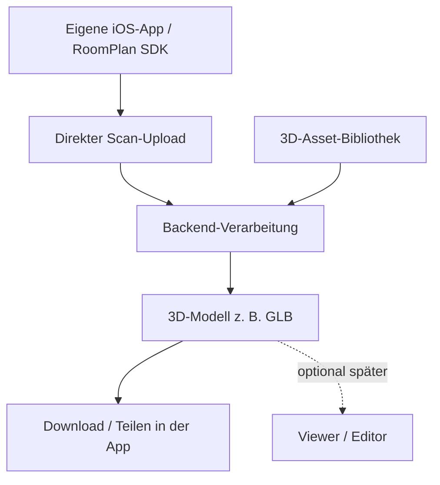

# Architektur 2 – Eigene iOS-App mit RoomPlan

> **Vorschlag, nicht beschlossen.** Die ursprüngliche Repository-Architektur beschrieb diese Variante als gesetzt. Tatsächlich ist sie nur eine Alternative zu [Architektur 1](option-1-external-scanner.md), die mit dem [Betreuer](decision.md) abgestimmt werden muss.

[Dokumentation](../README.md) · [Architektur 1](option-1-external-scanner.md) · [Vergleich](decision.md) · [System-Flows](system-flow.md)

## Idee

Eine eigene App nutzt Apples [RoomPlan-SDK](https://developer.apple.com/documentation/roomplan/), um den Raum zu scannen. Das Scan-Ergebnis wird **direkt aus der App** an das Backend gesendet; ein manueller Export und Upload in eine andere Anwendung entfallen. Das erzeugte Modell kann heruntergeladen oder geteilt und optional später direkt in der App angezeigt/bearbeitet werden.

## Geplanter Ablauf

1. Scan innerhalb der **eigenen iOS-App** beginnen.
2. RoomPlan liefert Raum- und Objektdaten; die App bereitet die Daten für den Upload auf.
3. **Direkte Übertragung** der strukturierten Scandaten an die API.
4. Backend führt Geometrie- und Asset-Verarbeitung aus.
5. Ergebnis z. B. als **GLB** zurückliefern und teilen. **On-Device-3D-Viewer und Editor sind Zukunftsoptionen**, keine Voraussetzung des ersten MVP.

## Möglicher Technikansatz – noch nicht festgelegt

- **React Native + Expo** für UI/Logik; mögliche Alternative wäre ein nativer iOS-Ansatz.
- RoomPlan über einen nativen Wrapper, z. B. **expo-roomplan**; Wrapper- und SDK-Kompatibilität müssen am Gerät getestet werden.
- Gemeinsame Backend-Pipeline, z. B. Python/FastAPI/trimesh.

## Vorteile

- Kein Medienbruch zwischen Scanner und Upload.
- Einheitliche Bedienung und besser kontrollierbare Fehlerbehandlung.
- Späterer Viewer/Editor leichter im Produktfluss integrierbar.

## Nachteile / Risiken

- Zusätzliche iOS-UI und native Integrationsarbeit.
- Ein echtes **LiDAR-fähiges iPhone** ist für den Scan nötig.
- **Expo Go kann native RoomPlan-Module nicht einfach ausführen**; eine Development Build ist nötig.
- Native Builds müssen signiert werden. Bei EAS-Cloud-Distribution auf physische iPhones ist normalerweise eine kostenpflichtige Apple-Developer-Mitgliedschaft erforderlich; kostenloses Xcode-Testing mit persönlichem Account ist eingeschränkt möglich.
- **Eine Veröffentlichung im App Store ist für die eigene Entwicklung und Tests nicht erforderlich.**

## Minimaler Machbarkeitsnachweis

**Button „Scan“ → RoomPlan-JSON → Backend-Upload → GLB → Teilen.** Der Mobile-3D-Editor wird erst nach funktionierender Pipeline evaluiert.

Der [Handytest](../testing/handytests.md) richtet sich primär an Architektur 1, kann aber auch für die gemeinsame Backend-Entwicklung echte JSON-Fixtures liefern. Für Architektur 2 kommt zusätzlich ein **eigener iPhone-Build- und RoomPlan-Test** hinzu.

[Architektur 1](option-1-external-scanner.md) · [Entscheidungskriterien](decision.md) · [Technologieoptionen](tech-stack.md)
