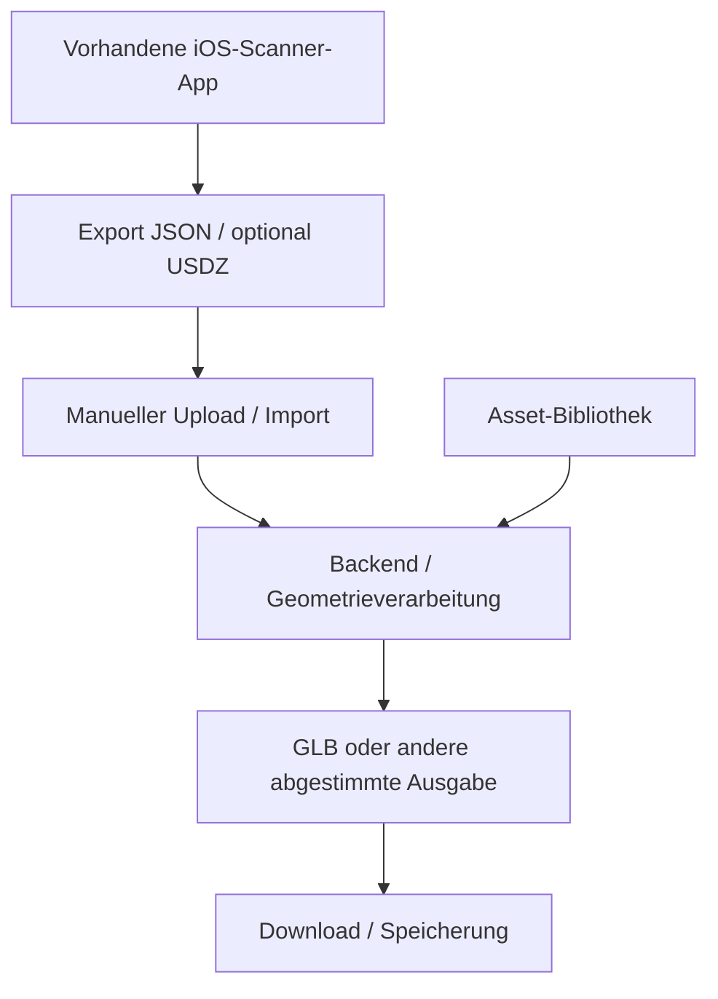
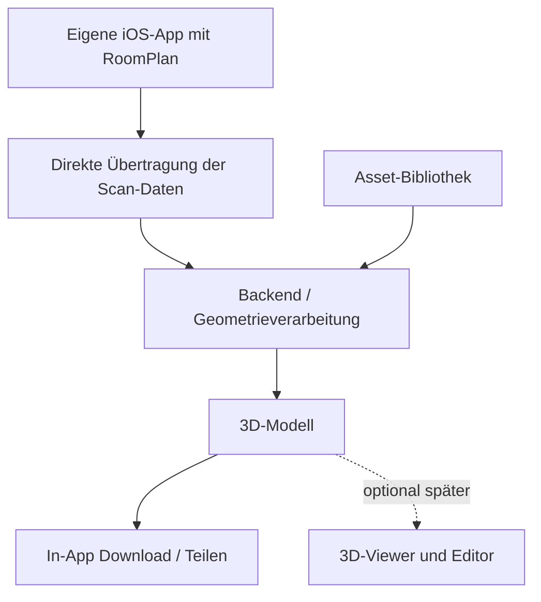

# System-Flows – zwei getrennte Alternativen

**Architekturentscheidung noch offen.** Die folgenden Flows sind Vorschläge, keine freigegebene Architektur. [Entscheidungsstand](decision.md) · [Dokumentationsübersicht](../README.md)

## Architektur 1 – Externe Scanner-App

[Ausführliche Beschreibung](option-1-external-scanner.md)

**Offene Voraussetzung:** Ist der JSON-Export wirklich kostenlos und für die Pipeline brauchbar? Siehe [Handytests](../testing/handytests.md) und [PDF](../../test/architecture%20research/Room_Twin_Handytests_RoomPlan_JSON-1.pdf).

## Architektur 2 – Eigene integrierte App

[Ausführliche Beschreibung](option-2-integrated-ios-app.md)

**Offene Voraussetzung:** Kompatibler native RoomPlan-Build, Signierung und Datentransfer müssen auf einem echten Gerät geprüft werden.

Beide Varianten können eine gemeinsame Verarbeitungspipeline verwenden; der [Technologiestack ist noch nicht festgelegt](tech-stack.md).
