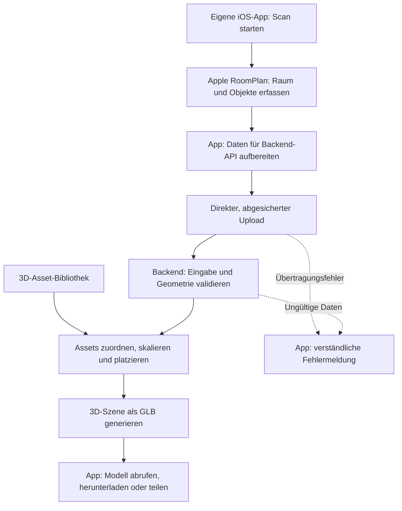

# Systemablauf – Room Twin

**Verbindlicher Ablauf:** Die eigene iOS-App erfasst Räume mit Apple RoomPlan, überträgt strukturierte Scandaten direkt an das Backend und macht das daraus generierte 3D-Modell verfügbar.

[Systemarchitektur](architecture.md) · [Dokumentationsübersicht](../README.md)

## Scan bis Ergebnis

## Verantwortlichkeiten

- **iOS-App:** Native RoomPlan-Erfassung, Scan-Aufbereitung, direkter API-Aufruf, Anzeige des Verarbeitungsstatus und Bereitstellung des Ergebnisses.
- **Backend:** Datenvalidierung, Geometrie- und Transformationslogik, Asset-Zuordnung und GLB-Generierung.
- **Asset-Bibliothek:** Geeignete Ersatzmodelle; für den MVP ist eine lokale Bibliothek ausreichend.

Das konkrete API-Schema und das Verhalten bei asynchroner Verarbeitung müssen vor der Integration spezifiziert werden. Das Diagramm beschreibt die **festgelegte logische Architektur**, noch keine implementierte Pipeline.

## Späterer Ausbau

Nach dem MVP kann die App um einen 3D-Viewer und gegebenenfalls einen Editor erweitert werden. Diese Erweiterungen sind **nicht Bestandteil des ersten MVP**.

[Technikstack](tech-stack.md) · [Tests](../testing/ios-roomplan-validation.md)
